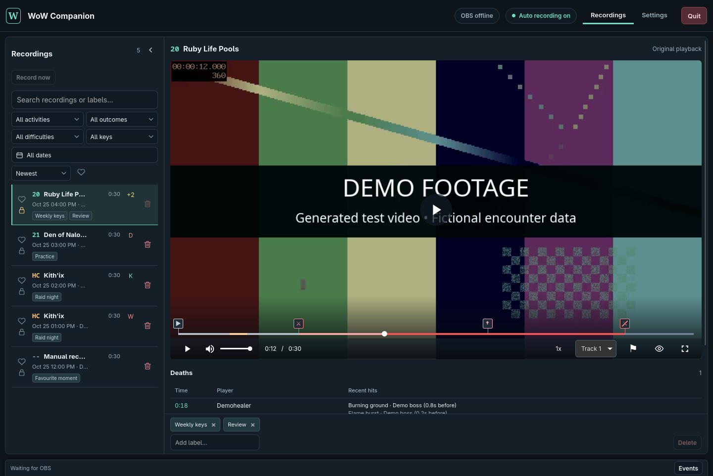

# OBS WoW Companion

Record WoW encounters with your existing OBS setup, review deaths and boss markers, and share clips with your group. Free, open source, and built for Windows and Linux.

[Download the preview](https://github.com/jmylchreest/obs-wow-companion/releases) · [Player guide](https://jmylchreest.github.io/obs-wow-companion/guide/quick-start.html) · [Website and demo](https://jmylchreest.github.io/obs-wow-companion/) · [Report a problem](https://github.com/jmylchreest/obs-wow-companion/issues/new/choose)



This is an **early testing preview**. Linux and Windows packages pass automated checks, but real gameplay coverage varies. Try a short recording before relying on it for raid night. [Tested platforms and modes](https://jmylchreest.github.io/obs-wow-companion/guide/compatibility.html).

- Record supported encounters automatically from the combat log, or use **Record now**.
- Jump five seconds before a death, seek boss markers, slow playback and select audio tracks.
- Find runs by activity, difficulty, key level, date or labels. Favourite useful pulls and protect recordings you want to keep.
- Export a ZIP containing the video, markers and an offline web player.

OBS handles capture, scenes, audio and recording encoders. Install OBS and FFmpeg separately, follow setup, select WoW's Logs folder and enable `/combatlog`. There is no account or automatic upload. Recordings started independently in OBS remain under your control.

The [HTML player guide](https://jmylchreest.github.io/obs-wow-companion/guide/quick-start.html) covers setup, review, sharing and troubleshooting. Future release archives include it too: open `site/guide/quick-start.html` locally. Public screenshots use obscured, muted Ruby Life Pools footage with demonstration markers and library data.

## Building from source

Use Rust 1.95 or newer and the platform build dependencies in [Development](docs/development.md):

```sh
git clone https://github.com/jmylchreest/obs-wow-companion.git
cd obs-wow-companion
cargo run --locked --bin obs-wow-companion
```

[Contributor documentation](docs/README.md) · [Changelog](CHANGELOG.md)

## Licence

[MIT](LICENSE). Dependencies retain their own licences; see [third-party notices](THIRD-PARTY-NOTICES.txt).

An independent community project, not affiliated with Blizzard Entertainment or the OBS Project. World of Warcraft is a trademark of Blizzard Entertainment.
