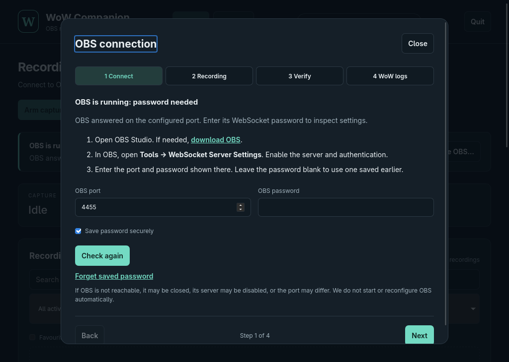
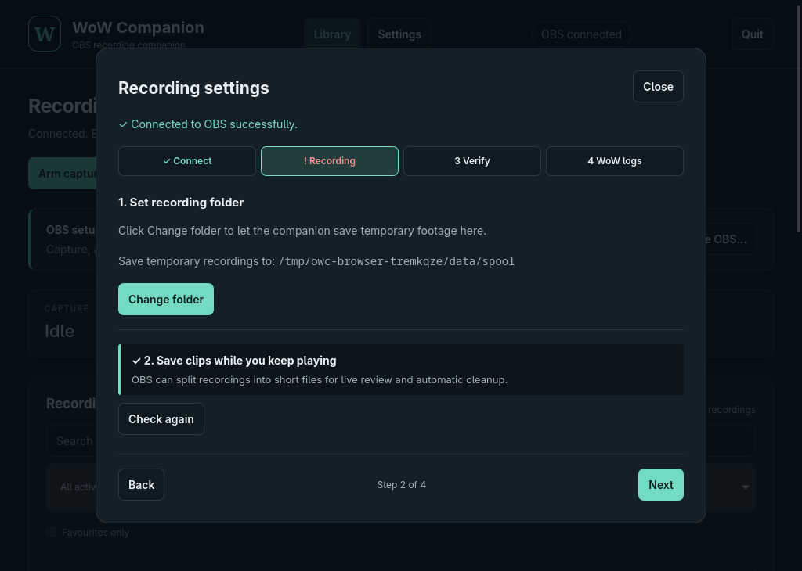
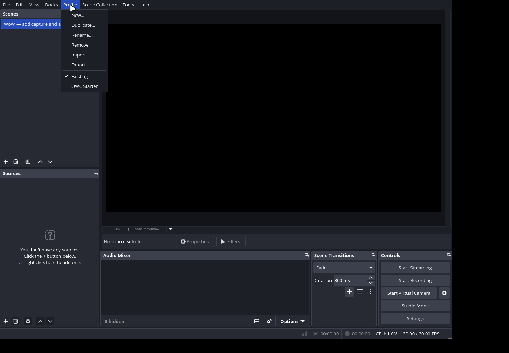
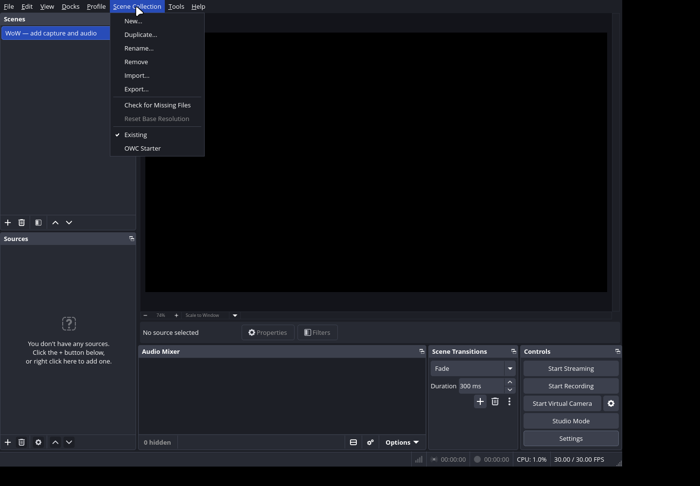
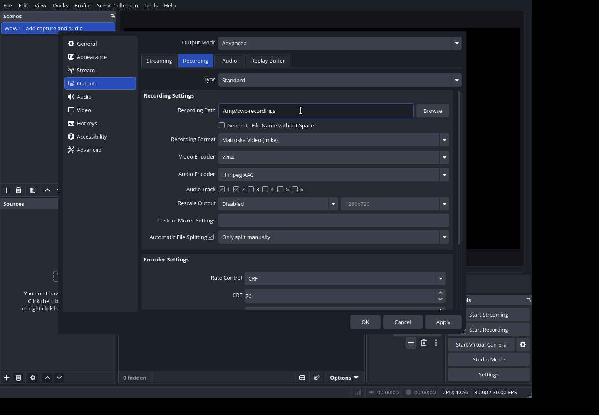
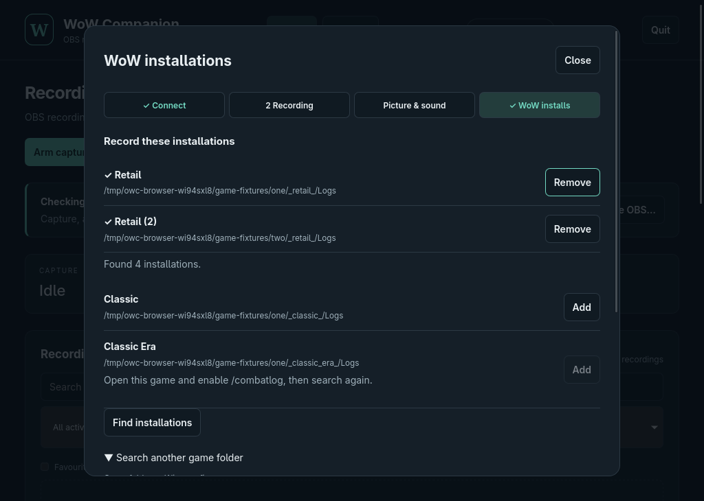

# OBS setup

Development build setup. The companion and native desktop window work locally; platform release qualification is still in progress. See [validation evidence](validation.md) for tested versions and remaining gates.

## Startup readiness and guided setup

On startup, the companion checks the configured local OBS WebSocket port. It distinguishes a recognised OBS server that needs authentication from an unreachable or unsupported endpoint. **Not reachable** does not prove OBS is closed: its WebSocket server might be disabled or configured on another port. Checks refresh approximately every 15 seconds and can be requested with **Check again**.

When connection/setup is needed, a four-step wizard opens:

1. Open or install OBS, enable its WebSocket server and enter the port/password. Select **Next** or **Check again** to connect, save the password securely when enabled, and verify. Success is shown and advances to recording settings; each step remains clickable so you can revisit passed checks while resolving later problems.
2. Review read-only checks for the recording directory, active outputs, manual splitting and enabled scene sources. The Recording tab presents two checks. **Change folder** applies the displayed temporary recording location in one click while OBS outputs are idle. The second check explains how to save clips while recording continues.
3. Picture and sound provides optional help. Choose Next if OBS already records correctly; no confirmation checkbox is required. Automatic checks still flag missing FFmpeg/ffprobe.
4. Select any detected WoW installations. You can add several, search another game folder or Wine prefix, or add a Logs folder manually. Each added installation appears in the list and can be removed. Manual clips only remains an option. Finish setup stays at the bottom right and returns you to any required check that is still incomplete. Connection messages appear only on the Connect step.

The Recording tab shows two numbered checks, with the folder action directly below its destination.

Use **Close** to dismiss the wizard and browse your library; **Configure OBS…** reopens it. Completion is remembered. With **Save password securely** enabled, a successful connection saves the password in the operating system credential store. Finishing enables automatic recording for future supported encounters. Automatic checks neither start OBS nor change its recording, streaming, replay buffer, scenes or encoders. A recognised source or a successful synthetic test cannot prove that actual gameplay/audio is being captured correctly.

## Choose an existing setup or a fresh one

Existing OBS users can keep their own configuration. For a dedicated setup, create a profile and scene collection named `WoW Companion`. Export your current profile and collection first if you want a backup, and retain their names for switching back.

An OBS profile holds output/video settings; a scene collection holds scenes, sources and global audio sources. One does not substitute for the other. Use their respective **Profile** and **Scene Collection** menus. See the official [profiles](https://obsproject.com/kb/profiles) and [scene collections](https://obsproject.com/kb/scene-collections) guides.

Use the [native starter profile and scene collection](../templates/obs/README.md) for a fresh setup. They contain no passwords, recording paths or physical devices. The older JSON recipe is a checklist, not an OBS import.

## Configure game capture

Create a scene named `WoW`, then select a capture source that works on your system:

| Environment | Starting point | Verify |
| --- | --- | --- |
| Windows | OBS Game Capture targeting WoW; use another supported source if needed | Game remains visible during actual play and fullscreen transitions |
| Linux Wayland | OBS PipeWire screen/window capture through the desktop picker | Permission granted, correct source selected, behavior after restart |
| Linux X11 | Available OBS window or display capture | Correct WoW window/display, especially with Wine and multiple monitors |

Source names and available choices vary by OBS build and desktop. Wayland window selection depends on the portal backend. See [OBS Game Capture](https://obsproject.com/kb/game-capture-source) and the [ScreenCast portal](https://flatpak.github.io/xdg-desktop-portal/docs/doc-org.freedesktop.portal.ScreenCast.html).

Use the preview to fit the game to the canvas. Add any desired chat masks or overlays as OBS sources. The companion uses the recording composition, so verify scene changes do not unexpectedly replace gameplay. A source showing a black screen is not ready even if the connection succeeds.

## Configure audio

Select the actual game/system output device and optional microphone. Verify their meters move, and avoid capturing the same device through both a global source and an explicit scene source.

Suggested track layout:

| Track | Contents |
| --- | --- |
| 1 | Game/system audio plus microphone: convenient playback mix |
| 2 | Game/system audio only |
| 3 | Microphone only, if used |

Set source routing in OBS Advanced Audio Properties and enable the corresponding recording tracks in output settings. Noise suppression, push-to-talk and audio monitoring remain OBS settings. Avoid monitoring feedback. See the official [multiple audio tracks guide](https://obsproject.com/kb/multiple-audio-track-recording-guide).

Before trusting the setup, play back a test and select each recorded track. Moving meters alone do not prove that the intended streams reached the file.

## Configure recording output

The starter profile uses Advanced output, standard MKV recording, software H.264, AAC tracks 1 and 2, and 1280 × 720 at 30 FPS. Adjust these settings for your machine:

- Standard recording in Advanced output mode, with MKV as the initial container to validate.
- 1920 × 1080 at 60 FPS as a starting preset, not a requirement; lower resolution or frame rate if capture competes with the game.
- H.264 video and AAC audio as initial playback-compatibility candidates. Choose an encoder actually available on the machine. Do not import a preset naming an unavailable GPU encoder.
- A dedicated writable recording directory for managed capture, accessible to both OBS and the companion. Exported encounter clips go in a separate library directory.
- Multiple audio tracks as above. Rate-control and quality values are selected per encoder; there is no universal NVENC/AMD/Intel/software quality number.

Enable **Automatic File Splitting** in Advanced → Recording, with **Manual** as the split type. The companion requests the splits; OBS waits for a suitable boundary. Merely having the SplitRecordFile API available is insufficient. Simple output or disabled splitting uses whole-session fallback: clips wait until recording stops, and disk use can be much higher. Keep OBS replay buffer independent of companion capture.

For Flatpak OBS, confirm it can write the selected directory and the companion can read the same files. Check both paths actually refer to the same location; a successful WebSocket connection does not establish filesystem access.

Storage planning: at a measured total bitrate of 20 Mbit/s, an hour is approximately 9 GB in decimal units, before overhead. Variable bitrate and multiple tracks change the result. Allow room for active encounter sources, final clips and temporary export output; a short idle-history limit does not bound the size of an ongoing dungeon.

## Enable the OBS connection

In **Tools → WebSocket Server Settings**, enable the server and authentication. Use the port shown by OBS and keep the generated password private. The local connection defaults to `127.0.0.1:4455`; adjust it if your server uses a different port.

Enter the password through **Configure OBS…**; it must not be saved in the shared template. A profile/collection import does not replace this step. OBS includes WebSocket support from version 28, but bounded mode additionally requires split/file-change support and a tested output configuration. See the [official remote-control guide](https://obsproject.com/kb/remote-control-guide).

## Configure WoW logging

Enable combat logging using `/combatlog` or an appropriate logging addon, and enable advanced logging where required for the supported game mode. Select each actual installation/game version's Logs directory. On Linux this may be inside a Wine/Proton prefix or another game-library directory; do not assume a fixed prefix path.

The companion shows log activity and the configured flavour. Quiet gameplay can delay log writes; a missing immediate event is not automatically a broken path. Verify detection with a supported test activity.

## Verify automatic recording

In the companion:

1. Check the OBS preview, audio devices, output directory and connection status.
2. Make a short recording in OBS with movement, game sound and speech if using a microphone; inspect the result.
3. Verify the companion reports the required capture capabilities and reads the selected logs.
4. Complete setup and leave automatic recording enabled. A supported encounter start or PvP entry starts recording.
5. If OBS is already recording, the companion observes it. It must leave the recording untouched; clips may wait until the source file closes.
6. Complete a supported activity, confirm its outcome and marker timing, and play the exported clip with each audio track.

Use **Settings → Run setup wizard** to connect and apply the recording directory while OBS is idle. Use **Settings** to manage installations and preferences; storage/timing, activity filters and media tools expand when needed. Use **Record clip / Finish clip** while connected for an actual OBS test. On startup, the companion attempts to reconnect using the saved password without starting a recording until a fresh encounter. If OBS was unavailable, leave the password blank and select **Check again** to retry.

## Troubleshooting and rollback

| Symptom | Check |
| --- | --- |
| Cannot connect | OBS running, server enabled, matching port/password |
| Connected but black/silent video | Source selection, desktop permissions, audio routing and actual OBS output |
| No activities | Correct game/flavour log folder, logging enabled, supported parser/events |
| Missing start of an encounter | OBS startup latency, retained history and reported coverage gaps; event-triggered starts cannot guarantee lead-in |
| Clip pending indefinitely | Source still recording in observe mode, split support or queued export error |
| OBS path inaccessible | Shared directory permissions and Flatpak path visibility |
| Encoding overload | Lower capture load or change the encoder in OBS, then retest |
| Unexpected disk growth | Pinned long encounters, pending exports, whole-session mode and library quota |

To roll back a dedicated setup, finish recording/streaming normally and select your previous profile and scene collection. Removing the dedicated resources is optional; do not remove recording files as part of configuration rollback.

The desktop close button and compositor close shortcuts (such as niri’s Meta+C) request a normal quit. The app stops only companion-owned recording, saves active intervals as incomplete, and cancels unfinished encoding while retaining its sources and queued plan for the next launch. Sharing ZIP exports can be retried after restarting. Shutdown allows up to ten seconds for closure and cancellation cleanup after preparation, then exits using durable recovery state. You do not need to pause first, and your Auto recording preference is preserved. The **Quit** button follows the same shutdown flow. Closing OBS or changing its profile invalidates ownership; reconnection checks the new session before another encounter can record.

## Starter screenshots

OBS 32.2.2 on Linux, tested in an isolated configuration. Import adds **OWC Starter** alongside **Existing**; each menu independently selects its resource. The checkmark below shows rollback to the previous resource.

The imported recording settings enable MKV, x264, tracks 1 and 2, and manual splitting. The path shown below is an example entered for this screenshot; choose your own dedicated spool directory. An import leaves capture sources and physical audio devices unconfigured.

Precise exports temporarily store uncompressed audio before encoding the joined result. Budget about 0.69 GB per stereo 48 kHz track per hour for temporary audio, in addition to temporary video and the final clip. Failed jobs remove their temporary export directory; after a process crash, retrying that job recreates and cleans its staging files.

## Everyday controls

The recordings pane contains Record now (Stop recording while a manual clip is active). The Auto recording switch beside OBS pauses or resumes automatic recording. Capture status appears only in the footer. Manual clips are available while connected; live review appears while recording. Select a ready library recording to prepare playback automatically; changing its audio track prepares that track. A failed preview offers Retry playback. Recording tags, protection and deletion appear only after selection; the player bundle export panel opens by default. Protected recordings must be unlocked before deletion. Empty search results explain that filters can be changed instead of sending you back through setup.

## Saved passwords

**Save password securely** is enabled by default. Check again saves only a password that successfully authenticated with OBS. Windows uses Credential Manager; Linux uses a Secret Service provider such as GNOME Keyring. On niri, a Secret Service provider must be installed, running in the desktop session and unlocked. If storage fails, the connection still works for the session and the app explains how to retry. There is no plain-text fallback in SQLite, configuration files, browser storage or logs.

Saved entries belong to this companion data profile and OBS port. Changing the port uses a separate entry. **Forget saved password** removes the entry for the displayed port without disconnecting OBS. Unchecking Save password securely uses only the password entered for this session; it does not delete an earlier saved entry. Linux builds require the D-Bus development package (`libdbus-1-dev` on Ubuntu); the runtime requires libdbus.

## Multiple installations and discovery

The companion supports up to ten installations, including several copies of Retail, Classic or Classic Era. Each has its own name, Logs folder, game version and activity filters. The same Logs folder cannot be configured twice, including equivalent canonical paths. Identically named detected versions get distinct names such as Retail (2); rename them in Settings if desired.

The wizard searches common game locations, Wine, Lutris, Bottles and Steam/Proton prefix directories on Linux, and World of Warcraft under Program Files on Windows. Discovery is bounded by time, depth and entry count; it does not promise to find every custom drive or prefix. Use **Search another game folder** for custom locations, or add a Logs folder manually. Missing Logs folders are shown with instructions to launch the game and enable logging, rather than being silently created. Discovery suggests installations; it does not add them without your selection.

### Launcher-aware paths

Discovery uses the `steamlocate` Rust crate to locate Steam across platforms, including Windows registry locations and Linux native, Flatpak and Snap installations. It reads Steam's current `steamapps/libraryfolders.vdf`, including secondary libraries. It checks their `steamapps/compatdata` prefixes, including non-Steam Battle.net installations, and includes Flatpak Steam. It also reads WoW entries from Battle.net's `Agent/product.db`: under ProgramData on Windows and within discovered Wine/Proton prefixes. Windows drive paths in a prefix are resolved through `drive_c` or its `dosdevices` drive mappings. Missing, oversized or malformed metadata is ignored; discovered game folders are still validated. Launcher metadata is read only.

The expected macOS retail Logs location is `/Applications/World of Warcraft/_retail_/Logs`; user Applications and custom locations can differ. macOS path handling is prepared, but macOS application support and runtime testing remain pending. Steam installed somewhere nonstandard, custom launch-option prefixes and unavailable drive mappings may still need **Search another game folder**.

Metadata format references: [steamlocate](https://docs.rs/steamlocate/2.1.1/steamlocate/), [Battle.net database field definitions](https://github.com/lutris/lutris/blob/master/lutris/util/battlenet/product_db.py). These are best-effort launcher formats, not a promise that a future launcher update cannot change them.

Run setup wizard reopens at Connect with the current OBS port and configured installations. The password field stays blank for secure saved-password reuse. A completed setup with no installations restores the manual-clips option.

## Create and select a recording scene

1. Open WoW and OBS. In OBS's **Scenes** panel, choose **+** and name the scene **WoW**.
2. In **Sources**, choose **+**. On Windows, add **Game Capture**, choose capture of a specific window, and select WoW. On Linux Wayland, use the available PipeWire screen/window source and select WoW in the desktop picker. On X11, choose the available window capture source. Source names vary by platform and OBS build.
3. Fit the game to the canvas using the source's **Transform → Fit to screen** menu. Check that gameplay appears rather than a black window.
4. Check the Audio Mixer while the game makes sound. Set the correct audio devices in OBS, avoid capturing audio twice, and make a short recording to check playback. See the audio section above for track routing.
5. In the companion, open **Settings → Recording scene**, select **WoW**, then **Save preferences**. Use **Refresh scenes** if you just created it. Choose **Use the current OBS scene** to disable switching.

The companion changes the program scene before starting its own recording and restores the previous scene when that recording stops. Existing OBS recordings are observed without changing their scene. If you change scenes yourself, switch profiles/scene collections, or disconnect, the old scene is not restored. Automatic scene changes are blocked while streaming; OBS's program scene is shared by recording and streaming. Restoration is also skipped if streaming has started. A missing or renamed scene must be reselected before recording can start.

These controls use OBS's [scene requests](https://github.com/obsproject/obs-websocket/blob/master/docs/generated/protocol.md#getcurrentprogramscene). For OBS basics, see the official [Quick Start Guide](https://obsproject.com/kb/quick-start-guide).

## Leave the companion running

You can close and reopen OBS while the companion remains open. It retries connection after a short delay, increasing to at most 30 seconds between attempts. Saved credentials are reused; an authenticated session password can also be reused until the companion exits. Forgetting the password clears that session copy too. No password is written to app settings.

Closing OBS invalidates recording ownership and interrupts capture. Reconnection checks the new session and never assumes ownership of a recording started elsewhere. After reconnect, new supported encounters can start recording again; interrupted encounters are not silently resumed. Completed setup does not reopen as a modal merely because OBS is offline; use **Run setup wizard** if settings need attention.

## Automatic encounter recording and live updates

After setup, a fresh supported encounter start or PvP entry starts OBS recording. The existing combat-log detector covers supported raids, Mythic+, arenas, shuffle and battlegrounds; arbitrary zone entries do not trigger recording. Installation filters still apply. Multiple active encounters share the recording. When all tracked encounters finish, the companion retains the configured post-event footage, then stops only a recording it owns. Manual clips also delay that stop.

Use **Pause automatic recording** to stop companion capture and suppress new triggers; this choice survives restarting. **Resume automatic recording** waits for the next encounter. Manual clips remain available while connected. The companion ignores activity starts older than ten seconds to avoid recording replayed backlog. OBS disconnects invalidate the interrupted capture; after reconnection, the next fresh start can record again.

Recording starts after the log event arrives, so the first moments and configured pre-roll may be missing. Partial coverage is reported. For guaranteed lead-in, continuous buffering or earlier game-presence detection would be required. Existing user-started OBS recordings are never stopped by automatic encounter completion.

The library receives authenticated server-sent state events, including active encounters and export completion. It no longer polls the status endpoint periodically. Reconnecting the event stream delivers the latest full snapshot. The internal bounded event bus carries OBS WebSocket events with a connection generation; stale connections cannot affect the current session. Parsed log lifecycle events enter the same serialized capture controller. Log files are still tailed on a short timer; the bus does not imply OS filesystem notifications.

### Recording after a dungeon has started

Click **Record clip** to capture the rest of a dungeon when automatic recording missed its start. If you have multiple installations configured, choose the one you are playing beside that button. With one installation, it is selected automatically. Enable `/combatlog` in that game. Subsequent player deaths and boss starts/ends appear on the clip timeline and deaths table. Click **Finish clip** when done; a boss ending does not end the manual clip. Earlier footage and events are not reconstructed. Without a configured log source, manual clips still capture video but have no game markers.

### Review controls and markers

The bundled Video.js player provides play/pause, volume, speed, audio-track and fullscreen controls. For recordings with multiple audio tracks, the audio-tracks button opens a menu styled like marker filters. Choose one track to listen to; Escape or clicking outside closes the menu. Use Space or K to play/pause, Left/Right to seek 5 seconds, J/L to seek 10 seconds, and Shift+Left/Right for 0.1 seconds. While paused, comma/period steps by one nominal video frame (30 fps if frame-rate metadata is missing). M toggles mute, Up/Down adjusts volume by 5%, and < / > changes speed. Home/End jumps to the start/end; 0–9 jumps to 0–90%. Shortcuts work in the Recordings view when video is playable; typing, dialogs and focused controls retain their own keyboard behavior. M never starts or stops recording. Use the fullscreen button, double-click the video or press F outside an input field. Use Esc or the fullscreen button to leave fullscreen. The timeline and controls stay available in fullscreen.

Select a recording, then click the **flag** control and enter a label to mark its playback position. For a selected active activity, Mark records the current time. Click a flag on the timeline to return to that moment. Saved edits are reflected in the [JSON sidecar](sidecar-format.md).

To end an automatic encounter recording early, select the active recording and click **Stop recording** above the recordings list. Its outcome becomes abandoned and the captured footage is retained. Owned recording stops after the configured post-roll once no other activity or manual clip needs it. This does not abandon the key inside WoW.

Search matches recording names, characters, installations and labels, ignoring case. Existing labels appear as suggestions while typing; search never creates labels. Recording rows show labels beneath their details, fitting whole labels on one line. Hover that row of labels to see the full list.

Event signposts attach to the actual seek track. Hover or focus a signpost for its time and label, or click to seek. Red timeline sections indicate paired boss start/end events. Orange sections estimate group combat activity from damage or miss events, sampled at most once per second; gaps over five seconds split the sections. These are not exact player combat-state boundaries. Older clips without combat samples stay uncoloured outside known boss fights. Missing boss-end events do not imply that combat continued to the end of the video.

### Exporting a selected range

The Export panel starts collapsed. Click **Select range** to show In/Out handles on the player's timeline. Drag either handle, drag across the track to define a new range, or enter start/end seconds. Focused handles support arrow keys (0.1 seconds, or 1 second with Shift), Home and End. Controls remain visible during range selection, including fullscreen. Click **Clear range** to restore the full recording. **Export** saves a ZIP containing the video, a standalone player and portable metadata. A selected range produces a precise cut; clearing the range exports the whole video. Choose an output path and audio tracks in the panel. Delete sits with the labels in the pinned footer. See [Sharing recordings](sharing.md) for local playback and web hosting.

Signpost tooltips show the event label and time; the seek tooltip is hidden while hovering a signpost. Overlapping signposts stack upward with nearer stems layered in front. Boss-end signs use crossed-out combat icons.

Playback first tries the original recording in the embedded player. If unsupported, the app creates a cached MP4 with the selected audio track. Compatible H.264/yuv420p video is copied without re-encoding; other video formats are converted to H.264. Audio-track changes use the compatibility copy. Original recordings remain unchanged.

Open **Video details** below Export to inspect the original recording metadata and playback mode. The player reports Original playback or Compatible playback; the panel explains why a compatibility copy was requested. Preparing MP4 (video unchanged) means the video is copied into a different container, not encoded again. AAC audio is also copied unchanged. Converting video for playback means the source video requires H.264 conversion. Format support depends on the embedded platform decoder, so original-file playback is tested at runtime. Restart the desktop app after rebuilding it to load the new bundled UI and engine.

The eye button opens marker filters, including Toggle all. Markers are visible by default and filters are saved across restarts. Filtering changes the display without removing marker data or export range handles.

Recording results appear in a fixed-width column beside the duration: green K for raid kills, red W for wipes; green +1, yellow +2, bold gold +3 for timed keys and red D for completed depletes. Interrupted runs are not labelled as depletes. Old recordings without saved timing metadata and unknown dungeon timers show ? for completed keys.

Upgrade calculation uses the elapsed time in CHALLENGE_MODE_END, which includes death penalties, rather than video duration. The bundled timer snapshot covers Midnight seasons 1 and 2 from [Raider.IO static data](https://raider.io/api/v1/mythic-plus/static-data?expansion_id=11), retrieved 2026-10-25. Timer updates require updating `crates/wow-log/src/keystone_timers.rs`; the timer is stored on each new run. The +2/+3 thresholds are 80%/60%, with the same one-second grace used by Warcraft Recorder. Unknown timers do not produce guessed upgrade results.

Delete is in the review footer beside labels, and each saved recording has a trash button. Clicking asks for confirmation; Shift-click deletes immediately. Protected recordings must be unlocked first.

Click the OBS status pill for connection details; click elsewhere or press Escape to close it. It does not open setup and does not display a second hover tooltip. A pending recording may be waiting for an open OBS source file to close, especially after reconnecting in observe-only mode. The player clears the previous clip while waiting and loads the selected recording when its export becomes ready. Reconnecting can reclaim a companion recording when its saved checkpoint matches the OBS output path, advancing duration/byte counters and recently written fragment. Unrelated or unverifiable recordings remain observe-only.

Recording recovery saves the current fragment, media timeline boundary, OBS endpoint/output identity, counters, automatic-recording state and scene restoration target. A verified continuation resumes splitting and the normal post-roll stop; a completed fight does not require another pull to trigger that stop. Paused recordings, output replacement, clock changes and an unconfirmed split stay conservative because their timeline cannot be proved. Checkpoints cannot reconstruct fragments from older app versions that never saved them.

An unfinished Mythic+ run is abandoned after a logged zone change out of its dungeon followed by 60 seconds without returning. Returning within that grace period keeps the run active. Further combat or zone changes outside do not extend the grace period. Recording then stops after configured post-roll, unless another activity or manual clip still needs it. If the game emits no exit event, the normal inactivity timeout and manual Abandon action remain available.

## Advanced export settings

Settings → Advanced export settings controls how new clips are saved. Fast copy is the default. Existing profiles switch to it once on upgrade; later changes to Precise cuts are preserved across restarts. Already queued export plans retain their saved mode.

- **Precise cuts:** trim to the requested interval and re-encode. Select CPU, NVIDIA NVENC, Intel Quick Sync, AMD AMF or VAAPI. VAAPI is for Linux and has a device path setting, normally `/dev/dri/renderD128`. Other devices can be selected explicitly. GPU support depends on the installed FFmpeg build, hardware and driver; selecting an encoder does not guarantee it is available or faster.
- **Fast copy:** preserve the original video/audio codecs and quality. Compatible continuous fragments are concatenated directly without per-fragment media copies. The start is expanded to the preceding keyframe, and the saved timeline origin is adjusted so markers remain aligned. End timing is approximate. Explicit manual range exports still use precise cuts and the selected encoder.
- If copying or GPU encoding fails, the job retries the whole clip using CPU H.264 encoding. Video details shows the actual encoder and any fallback reason. Source footage stays protected while the export is pending. Full decode, duration and audio-track validation remain enabled.

Fast copy can retain a source codec that the embedded player cannot decode. In that case, playback can still need a compatible copy. Export settings do not change OBS recording settings, and GPU encoding does not enable GPU decoding. Changes apply to newly started export jobs; an already-running job retains its original settings. Recovered jobs retain their stored cut mode and use the current encoder setting.

FFmpeg and ffprobe are still external dependencies. Point Media tools to installed or app-adjacent executables if they are not on PATH. Bundling pinned media binaries is a packaging task; this change does not bundle them, download binaries automatically, or replace them with native Rust codecs.

FFmpeg references: [stream copying](https://ffmpeg.org/ffmpeg.html#Streamcopy), [concat demuxer requirements](https://ffmpeg.org/ffmpeg-formats.html#concat), and [hardware encoders](https://ffmpeg.org/ffmpeg-codecs.html).

## A completed encounter is still waiting

An encounter ending and its video being ready are separate steps. The clip status now identifies post-roll, waiting for the final OBS fragment, waiting behind another export, and the current saving stage. During saving, it shows source preparation, fragment encoding/copying, joining, or full video/audio validation plus elapsed time. These are actual stages, not a guessed percentage or completion estimate.

If the status says the companion does not own the recording, OBS was already active when connected and its saved ownership could not be verified. The companion leaves it running rather than stopping a potentially unrelated recording. Stop recording in OBS so the remaining footage can be checked. Closing that file is necessary, but interrupted timing or missing fragment metadata can still require recovery; the status does not promise that an unverified source will export automatically.

Recording titles use a two-character prefix: Mythic+ key level or retail raid difficulty (` M`, `HC`, `NM`, `RF`). Manual recordings use `--`; unknown difficulties and other activities have a blank prefix. Key levels are teal; Mythic, Heroic, Normal and Raid Finder use purple, amber, blue and green respectively; manual recordings use muted grey. Text remains the primary identifier. The original stored encounter names remain unchanged.

The deaths table includes up to three recent hits: ability, attacker and time before death. These come from the selected installation's combat log, including manual recordings. The ten-second window excludes stale damage; older recordings show **Not recorded**. No Warcraft Logs account is needed. Opening Settings pauses playback; returning to Recordings retains the source, position and speed.

### Events and inactivity

The bottom status bar opens **Events**, a searchable recent event history with **Follow** and **Save log** controls. Watcher status shows time since the last run action, whether an exit countdown exists, and the inactivity deadline. OBS recording/connection changes, encounter starts/ends, deaths and application messages are included. FFmpeg progress is sampled every five seconds, reporting its current stage, processed video time and speed; these are stage-local figures, not a whole-job completion percentage.

The most recent 500 entries are visible. `events.jsonl` in the application data directory rotates at approximately 1 MiB, retaining one `events.previous.jsonl` backup. This is a diagnostic event journal, not the raw combat log; it can contain player and encounter names. Passwords and raw API requests are not recorded. Existing terminal tracing remains separate.

If combat logging stops before WoW writes a zone-change or completion event, the companion cannot observe that you left. The fallback is five minutes without a group action (damage, healing, casts, misses, interrupts, dispels, deaths or resurrection) or encounter boundary. Background aura refreshes do not extend it. A confirmed dungeon exit still starts the separate 60-second grace period. The previous 30-minute default migrates once; other custom timeout values remain intact. Use **Stop recording** to end a known abandoned run immediately.

Click a death in the table or its timeline marker to seek five seconds before it (or the start of retained footage). Other marker types seek to their exact event time. Scroll over the video picture to zoom around the pointer, up to 6×; drag the zoomed picture to pan. Click **Reset** at the top left to return to 1×. The timeline and controls remain fixed, including in fullscreen. Zoom resets when a new video source loads and does not change exports.

### Review before the saved clip is ready

Select a finished encounter once its continuous source footage has closed. The player prepares a single MP4 from the retained fragments while final export and validation continue in the background. Compatible H.264 video and AAC audio are copied without encoding; unsupported video/audio formats are converted for playback. This avoids pauses at fragment boundaries, but preparation still needs disk I/O and cannot read an unfinished OBS file. Gaps are never silently joined.

The player identifies retained-footage playback. When the final clip becomes ready, your current video, position and speed stay unchanged. Markers and selected export ranges use the playback source's actual start time, including any keyframe expansion. Player bundle export becomes available after final publication. Retained review may omit post-roll that had not closed when playback was requested.

Playback preparation protects its source files from housekeeping. The completed playback copy is independent of the sources and uses the bounded preview cache; abandoned preparation directories are removed after restart.

Events opens above the status footer, aligned with the main panels. Drag its top separator to resize; arrow keys resize it when focused, Home/End choose the minimum/maximum height, and double-click restores the initial height just below the video where space permits. Collapse returns to the status bar. Events scroll independently and retain search, Follow and Save log controls.

The player eye button opens Marker filters. Toggle all shows or hides all signposts; individual categories come from the selected recording, including new event types. Preferences persist across restarts. Disabling a combat category also hides its corresponding timeline shading; the deaths table stays available independently. Signposts only stack when their icons overlap at the current timeline width.

### Browsing large libraries

Filters stay above the independently scrolling recordings list. Difficulty and exact key-level choices come from the library, with a single date-range control and the sort row underneath. Click a start and end date, then Apply. Escape, Cancel or clicking outside discards draft changes. The clear button beside an active range, or All dates inside the picker, removes the filter. The review area scrolls separately; long death tables have their own scroll area. Labels and Delete occupy a reserved footer below the review content.

### Routing sources to audio tracks

Open **Edit → Advanced Audio Properties** in OBS. The Tracks 1–6 checkboxes route each source into the checked tracks. A useful arrangement is all sources on track 1 (full mix), game audio alone on track 2, and microphone alone on track 3. Then enable tracks 1, 2 and 3 under **Settings → Output → Advanced → Recording**. Source routing and enabled recording tracks must both be configured. Use the Audio tab under Output to give tracks meaningful names. These changes affect future recordings.

For a shared video, export track 1 alone or mix tracks 2 and 3. Combining the full mix with its isolated tracks duplicates their sound. See the [OBS multi-track recording guide](https://obsproject.com/kb/multiple-audio-track-recording-guide).

For recordings with multiple audio tracks, the player control bar shows a track dropdown with embedded names. Switching keeps the current position, speed and play/pause state. Preparing a track may take a moment on first use; this playback choice is independent of export track selection.

### Restarting WoW on niri

PipeWire window capture can lose its selected window when WoW restarts. Windows Game Capture matching options do not apply to that source. Niri provides a **niri Dynamic Cast Target** in its capture chooser. Selecting it keeps OBS attached to a stream whose target can be changed using `niri msg action set-dynamic-cast-window` for the focused window, or `--id WINDOW_ID` for a known window. Closing the target clears the stream; it does not automatically find a replacement. An app-ID/title watcher could retarget a new WoW window, but Companion does not currently implement that integration. All dynamic casts share one target. See [niri screencasting](https://github.com/niri-wm/niri/wiki/Screencasting).
