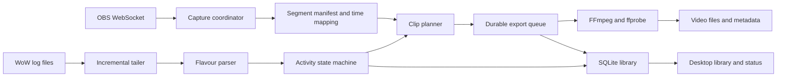

# Design: OBS WoW Companion

Status: first-release requirements, updated 2026-10-25. Implementation is underway; the matrix describes required scope, not verified support. See [validation](validation.md) and the [implementation plan](implementation-plan.md) for current evidence.

## Overview

Build a local-first Rust desktop companion for OBS Studio on Linux and Windows. Automatically identify World of Warcraft activities from combat logs, retain the relevant video, and make recordings easy to find, review and clip.

Aim for broad parity with Warcraft Recorder's **local** recording and review workflow. Reuse users' existing OBS configuration. Do not require a modified OBS build, capture plugin, account or cloud service.

The user has chosen Rust, cross-platform support, a separate OBS companion, and inclusion of all previously proposed MVP and 1.0 features in the first public release. Storage design and defaults below remain proposed implementation choices. “OBS” is the interpretation of “iobc” in the request.

## Feature comparison

Baseline: Warcraft Recorder source commit `2643938980b9fe2031aa17275d3ee528bd2fd20e`, application version 7.13.4. Its supported game flavours have differing coverage; “present” does not mean every flavour supports that feature.

**First release** = required for the first public release, combining the former MVP and 1.0 scope. **Later** = possible, not committed for the first release. **OBS** = available through OBS rather than recreated in the companion. **Excluded** = outside the current product scope.

| Capability | Warcraft Recorder baseline | Companion target | Qualification |
| --- | --- | --- | --- |
| Windows desktop | Supported | First release | Native Rust application plus native OBS |
| Linux desktop | Officially unsupported | First release | Wayland and X11 validation required |
| macOS | Officially unsupported | Later | Keep core portable; no release support claim until tested |
| Automatic raid encounter recording | Present | First release | Retail first; all logged raid difficulties, kill/wipe/reset outcomes |
| Whole Mythic+ runs | Present | First release | Keep one run with nested boss events; abandoned runs retained as incomplete |
| Arenas and skirmishes | Present | First release | Mode-specific handlers and fixtures |
| Solo Shuffle | Present | First release | Match recording with individual round markers |
| Battleground recording | Present | First release | Only modes with validated boundaries; no inferred universal support |
| Classic family | Present, uneven coverage | First release | Publish a flavour/activity matrix; validate each supported client version |
| Special world/delve encounters | Selected cases | Later | Explicit supported encounters; not arbitrary quest combat |
| Select recording categories/difficulties | Present | First release | Independent preferences per configured installation |
| Delayed-log start recovery | Buffered capture | First release | Retrospective extraction from already-recorded footage |
| Configurable pre/post encounter footage | Buffered start and overrun | First release | Example defaults: 5 seconds before, 10 after; never claim unavailable history |
| Manual recording/clip selection | Present | First release | Manual interval on the current session; works without log detection |
| Review while still recording | Instant replay | First release | Review closed segments; small delay, not playback of the current open file |
| Encounter metadata | Present | First release | Character, realm, activity, difficulty, outcome, duration, key level where logged |
| Death and boss timeline markers | Present | First release | Derived from available events, not combat meters |
| Boss health/progress display | Present | Later | Log-version-dependent; no universal accurate percentage promise |
| Search, sort and filters | Present | First release | Date, character, activity, outcome, difficulty, key level |
| Playback and marker seeking | Present | First release | Validate supported codecs on both operating systems |
| Playback speed and audio-track selection | Present | First release | Preserve recorded tracks during extraction |
| Trim and export clips | Present | First release | Fast keyframe-aligned copy; precise re-encoding included in the first release |
| Tags, favourites and protected recordings | Present | First release | Protection prevents automatic deletion |
| Storage quotas and cleanup | Present | First release | Separate spool/library budgets and minimum free space |
| Scene editor, source preview and transforms | Embedded | OBS | Configure and preview in OBS; companion shows connection/readiness |
| Microphone, game audio, noise filters and PTT | Embedded controls | OBS | OBS owns mixing and hotkeys; no duplicate audio controls |
| Multiple audio tracks | Present | OBS + first release | Capture in OBS; preservation and selection in companion |
| Hardware encoders, resolution and frame rate | Embedded controls | OBS | GPU/driver/OBS dependent; no blanket encoder parity claim |
| Chat masking and visual overlays | Embedded options | OBS | Configure masks and overlays as OBS sources |
| Global companion shortcuts | Present | Later | In-app shortcuts first; Wayland support varies |
| Drawing annotations over playback | Present | Later | Useful but not a recording prerequisite |
| Cloud upload, shared guild library, video chat | Present | Excluded | Local export is supported; no hosted service or WCR backend integration |
| Correlated player POVs and rendered kill videos | Present | Later | Local multi-video import could be designed separately |
| Existing WCR library import | Existing format | Later | Read-only import requires a separately tested format adapter |
| Background operation and startup convenience | Present | First release | Tray where supported; visible status fallback; explicit autostart setting |
| Localisation | Present | Later | English first; Unicode names and time-zone handling from day one |

Feature evidence: [README](https://github.com/aza547/wow-recorder/blob/2643938980b9fe2031aa17275d3ee528bd2fd20e/README.md), [changelog](https://github.com/aza547/wow-recorder/blob/2643938980b9fe2031aa17275d3ee528bd2fd20e/CHANGELOG.md), [renderer components](https://github.com/aza547/wow-recorder/tree/2643938980b9fe2031aa17275d3ee528bd2fd20e/src/renderer), [parsers](https://github.com/aza547/wow-recorder/tree/2643938980b9fe2031aa17275d3ee528bd2fd20e/src/parsing).

## User workflow

1. Select the WoW installation/flavour and its log directory. Manual paths always work, including Wine/Proton prefixes; automatic discovery is a convenience.
2. Connect to local OBS using its WebSocket port and password. Show actionable errors for authentication, missing capabilities and inaccessible recording paths.
3. Configure capture/audio in OBS. Make a short recording in OBS and play it back to confirm picture, audio and timing. A connected socket alone is not proof of working capture.
4. Choose recording categories, storage limits and capture ownership mode. Enable combat logging with an appropriate addon or the in-game command.
5. After setup, automatic recording starts on fresh supported encounters when OBS is available. Show Auto recording on/paused beside OBS, manual Record now in the library, and capture/export status in the footer.
6. Activities appear in the library as detected, then become playable/exportable when their source files close and extraction completes.
7. Review deaths and boss events, tag/protect recordings, trim clips or open their folder.

No game memory reading or game input automation is needed. Capture is of the OBS recording output: if the user changes the program scene, the recorded content changes too. Independent game-only capture while streaming a different composition is outside the baseline.

## Recording model and ownership

### Managed capture

After setup, a fresh supported encounter starts OBS recording when idle and automatic recording is enabled. Overlapping activities and manual clips keep capture running until all required post-roll is complete. Then stop only the recording owned by the companion. This supersedes the original continuous-capture proposal at the user’s request. Pre-roll is available only when existing retained footage covers it; starting OBS at an encounter cannot recover earlier footage.

The prototype may use a single session file, with extraction after that file closes. The first-release target is bounded disk buffering using closed recording segments. Verify OBS `SplitRecordFile` and `RecordFileChanged` support at connection time and verify the configured output actually supports splitting. Both appear in WebSocket 5.5; a generic OBS 28/WebSocket 5 installation alone is not sufficient for this mode.

Proposed defaults: 60-second segments and a 120-second idle history. These are tunable targets, not guarantees about WoW log latency. Preserve any segments needed by an active activity or pending export. A long dungeon can exceed idle-history storage; budgets must account for pinned footage.

Request splitting without stopping the recording. Use confirmed paths and probed media timestamps to index closed files. Do not assume a split happens at the request timestamp, produces an exact duration, or is gap-free until measured. Never process or delete the currently open segment.

When an activity finishes, wait for required post-roll and segment closure, export its interval, validate the result, then release its source references. Keep ordinary OBS recording and replay buffer semantics separate; saving a replay buffer is not equivalent to converting it into an ongoing encounter recording.

### Observe existing recording

If OBS is already recording, default to observing it. Index events and create pending clip ranges, but do not stop, pause, split, rename, delete or change that recording. Export when the source closes; explain the resulting delay. Do not automatically adopt an existing recording as managed.

OBS does not provide an exclusive ownership lease for its global recording output. Maintain conservative local ownership state. Unexpected stop/start, pause, profile change, connection loss or restart invalidates ownership; reconnect and query state before taking action. An ambiguous state becomes observe-only. Verified persisted ownership may be restored only after reconnect checks confirm the same recording; otherwise leave the existing recording untouched. Never issue destructive controls just because a previous process believed it owned capture.

Streaming is left untouched. Recording concurrently with a stream must be tested for load and output-setting compatibility. The companion cannot create an independent second standard recording output through this design.

Closing the desktop window or choosing Quit exits the application after bounded shutdown handling. Opt-in sign-in startup is supported. Normal closing must not silently minimise to a tray.

### Timing and failure behavior

- Keep raw log timestamps, UTC-normalised event times, file offsets, receive times and monotonic session timing separately.
- Map activity time onto actual media time using OBS status observations and probed segment durations. Record mapping uncertainty. Do not equate WebSocket round-trip completion with the first encoded frame.
- Handle clock changes, sleep/resume, midnight/year rollover, log time-zone interpretation and recording pauses as discontinuities. Mark missing intervals; do not silently compress them into apparently continuous gameplay.
- If a start event is older than retained footage, save what exists and label it truncated. If no matching video exists, retain metadata with an explicit unavailable reason.
- On incomplete/ambiguous end events, retain an incomplete activity; configurable timeout is a fallback, not a fabricated kill/wipe result.
- Log rotation, truncation, duplicate notifications and partial lines must not duplicate activities. Start at the current end for existing files by default; any historical recovery is explicit.
- Observe-only source files are never quota-managed. Managed source cleanup is restricted to registered files in the dedicated spool and rejects paths escaping that directory.
- On disk pressure, delete eligible unpinned spool files first. If that is insufficient, stop only clearly owned capture, mark affected work incomplete and notify. Never sacrifice protected clips or someone else's recording to meet a quota.
- After a crash, reconcile the durable manifest with actual files and resume idempotent export jobs. An uncertain active file remains untouched.

## Platforms and compatibility

Initial release targets: Windows x86-64 and Linux x86-64. Validate Linux on GNOME Wayland, KDE Wayland and an X11 session, using a documented OBS installation method. Flatpak OBS additionally needs shared access to output paths; do not claim sandbox compatibility until tested. ARM and macOS are later targets.

Use the OBS capability list rather than assuming capabilities from a version number. The compatibility spike will establish the minimum tested OBS release, supported output mode/container, codec combinations and segment behavior. Recommend a recovery-friendly container such as MKV for the initial test path; exact support is a release gate.

The companion does not implement PipeWire, Windows game capture or hardware encoders. OBS owns those differences. Wayland source selection still involves the desktop portal; initial permission prompts cannot be eliminated by the companion. See the [ScreenCast portal](https://flatpak.github.io/xdg-desktop-portal/docs/doc-org.freedesktop.portal.ScreenCast.html).

Remote OBS is outside the first release: WebSocket control alone does not provide access to remote video files or solve clock synchronisation.

## Interfaces

Illustrative contracts, not committed crate APIs. Keep domain transitions synchronous and I/O in adapters.

```rust
struct Activity {
    id: ActivityId,
    parent: Option<ActivityId>,
    kind: ActivityKind,
    start: EventTime,
    end: Option<EventTime>,
    outcome: Outcome,
    markers: Vec<Marker>,
}

enum ActivityKind { Raid, MythicPlus, Arena, SoloShuffle, Battleground, Manual }
enum Outcome { Success, Failure, Abandoned, Unknown }
enum CaptureOwnership { Managed(SessionId), Observed, Uncertain }

struct CaptureSegment {
    id: SegmentId,
    session: SessionId,
    path: PathBuf,
    media_start: Duration,
    media_duration: Duration,
    closed: bool,
}

struct ClipPlan {
    activity: ActivityId,
    sources: Vec<SegmentRange>,
    coverage: Coverage, // Complete, truncated, gapped, or unavailable.
    destination: PathBuf,
}

trait ActivityDetector {
    fn ingest(&mut self, event: LogEvent) -> Vec<ActivityChange>;
    fn tick(&mut self, now: EventTime) -> Vec<ActivityChange>;
}

trait ClipPlanner {
    fn plan(&self, activity: &Activity, timeline: &CaptureTimeline)
        -> Result<ClipPlan, PlanError>;
}
```

OBS adapter contract: connect/authenticate, discover capabilities, query recording status, start/split/stop with ownership guards, and emit typed status/file-change/disconnect events. Calls have request IDs, timeouts and typed errors. Reconcile state before retrying a mutation with an unknown result.

Log adapter contract: bounded incremental reads, persistent file identity/offset and a partial-line buffer, filesystem notifications plus periodic reconciliation. Preserve provenance so replayed input can be deduplicated.

Media adapter contract: probe files, export plans, generate thumbnails and report progress/cancellation. Spawn FFmpeg with argument arrays, never shell interpolation. Validate duration, streams and decodeability before atomic publication; failure retains source references.

Repository contract: transactional activity/segment/job updates, schema migration, reference tracking, query/filter operations and explicit protection/deletion rules. Database writes must not block ingestion indefinitely.

## Data flow



## Key decisions

| Decision | Proposed choice | Rationale |
| --- | --- | --- |
| Product boundary | Separate OBS companion | User-selected direction; reuse capture and scene ecosystem |
| Core | Rust workspace; synchronous domain, Tokio at I/O boundaries | Imported aide Rust conventions; deterministic fixture tests |
| Capture control | Standard OBS WebSocket; no custom plugin required | Cross-platform protocol and existing OBS installations |
| Pre-roll | Use existing retained segments when available | Encounter-triggered capture cannot recover footage from before OBS started |
| Storage | SQLite metadata/job queue, ordinary video files, versioned JSON sidecars | Search, recovery and portable per-clip metadata |
| Media processing | FFmpeg/ffprobe subprocess adapter | Avoid writing codecs/muxers; keep packaging replaceable |
| UI | Desktop interface; toolkit chosen after playback spike | Codec and packaging behavior matter more than an early toolkit commitment |
| Networking | Local OBS connection by default; no account or telemetry requirement | Local-first scope |
| Credentials | OS credential store where available, session-only fallback | Keep OBS passwords out of logs, exported settings and sidecars |

The implementation uses Tao/Wry with a bundled local HTML interface and an authenticated loopback service. Dependencies are pinned in Cargo.lock. OBS and FFmpeg/ffprobe remain separate installations. The final supported OBS/output matrix still requires platform qualification.

Implement independently unless upstream code reuse is deliberately selected. Upstream license declarations differ between files; resolve provenance and project licensing before copying code/assets or distributing a derivative. Feature compatibility alone does not require copying source.

## Release plan

### P0: compatibility prototype

Prove native OBS capture on Windows and Linux, delayed-event alignment, segment splitting/closure, multi-segment extraction, audio continuity, output ownership and crash recovery. Compare a visible timecode and audio test signal across splits. Choose the minimum OBS/output combination and playable distribution formats based on results.

If splitting cannot meet correctness requirements on a target configuration, offer explicitly labelled whole-session mode with extraction after stop and its larger disk requirement. Do not advertise bounded buffering for that configuration.

### First public release: broad local feature set

Ship all features marked **First release** together: Retail raids and Mythic+, validated arenas/skirmishes, Solo Shuffle, battlegrounds and Classic coverage; managed/observe capture; delayed-log recovery; live review of closed segments; metadata and markers; searchable playback; fast and precise exports; audio-track preservation/selection; tags, protection and quotas; manual intervals; background operation and Windows/Linux installers.

Documentation, a supported OBS starter configuration and setup diagnostics are release deliverables, not follow-up work. Publish a game-flavour/activity/platform compatibility matrix with fixtures for every supported combination. Classic and battleground support must have explicit tested coverage rather than an ambiguous blanket claim.

Implementation may proceed through internal PvE, PvP/Classic and review/packaging milestones. These are development checkpoints, not reduced public releases. Bounded capture and live review require P0 validation on the supported configurations. Whole-session mode remains an explicitly limited fallback and does not satisfy the live-review release gate by itself.

### OBS documentation and starter configuration

Maintain the [OBS setup guide](obs-setup.md), [native starter exports](../templates/obs/README.md) and [readable recipe](../templates/obs/recording-starter.json). The recipe is a checklist; import the separate native files. Linux menu-driven imports have passed; Windows import qualification remains required.

For the first release, ship validated native OBS **profile and scene-collection exports** for the tested OBS release(s), with a version manifest and import instructions. Keep the hand-written recipe as the readable source of intended defaults. Generate/export the actual files using the validated OBS version and test their import on clean Windows and Linux installations; do not hand-author undocumented OBS configuration internals.

Profiles and scene collections cover different settings. Include a minimal scene layout with clearly labelled capture/audio setup instructions; select platform-specific capture sources, devices, paths and available encoders during onboarding. Never ship personal device IDs, absolute developer paths, stream credentials or WebSocket passwords. A new installation must remain visibly unconfigured until these selections are completed.

Existing OBS users can use their own profile/collection. Imports create separate named resources and must not replace existing configuration. Any companion-assisted settings changes show a reviewable diff and apply only while outputs are idle; no automatic encoder, scene, audio or streaming changes during recording. WebSocket authentication is configured separately.

The guide must cover platform capture selection, audio tracks, output/encoder configuration, WebSocket authentication, profile/collection import and rollback, shared paths for Flatpak, combat logging, storage estimates, managed versus observe mode, and troubleshooting. Include tested screenshots before release.

### Later or excluded

Later: annotations, local multi-POV review, WCR import, macOS, translations and global shortcuts. Excluded from current scope: hosted guild storage/chat, WCR cloud compatibility, embedded capture, independent recording compositions, remote OBS, general combat analytics and support for every game.

## Acceptance criteria

These are release requirements, not results already achieved.

- [ ] On both target OSes, verify real OBS recordings play with video and selected audio, and setup distinguishes bad credentials, missing permissions and missing logs.
- [ ] A raid start delivered 30 seconds late produces the requested pre-roll when retained footage exists; a start outside retention is labelled truncated.
- [ ] A 45-minute M+ fixture with nested encounters produces one run, correctly placed boss/death markers and no duplicate raid recordings.
- [ ] Rapid consecutive pulls with overlapping padding produce two correct clips sharing source segments safely.
- [ ] Rotated/truncated logs, partial UTF-8 lines, repeated notifications and replay after restart do not duplicate activities or lose completed lines.
- [ ] Clock change, pause/resume and disconnect fixtures expose coverage gaps rather than misleading continuous timestamps.
- [ ] Gap-free split behavior is demonstrated with frame timecodes and continuous audio on each supported OBS/output combination before enabling bounded mode.
- [ ] Marker alignment targets at most one second error in the calibrated test, with uncertainty surfaced when unavailable. Fast-cut boundaries may move by the measured keyframe interval; precise export is tested separately.
- [ ] Connecting to, disconnecting from or restarting around a user-owned recording never sends stop/pause/split controls or deletes its files.
- [ ] Capture never interrupts streaming; load tests report any rendering/encoding drops rather than attributing them silently to the game.
- [ ] Simulated crash during export leaves recoverable sources; restart creates at most one published clip per job.
- [ ] Quota tests preserve open files, pinned sources, protected clips and all external recordings. Insufficient space produces explicit status and bounded failure handling.
- [ ] Multi-track recordings retain their streams; supported playback/export combinations are documented and exercised on Windows and Linux.
- [ ] In a synthetic 10x fixture-ingestion benchmark, queues remain bounded and all relevant events are retained. Publish fixture size and reference hardware; do not promise an unmeasured CPU budget.
- [ ] Once final source closure is confirmed, export queues within two seconds on the reference machine. Completion depends on duration/codec and is shown as progress.
- [ ] First-release game-mode support is backed by labelled fixtures including success, failure, abandonment and zone changes; unknown formats show degraded support.
- [ ] Documentation includes getting started, OBS configuration, ownership behavior, storage sizing, recovery and the tested compatibility matrix.
- [ ] Every former 1.0 feature is exercised before the first public release, including PvP/Classic fixtures, live review without capture interruption, precise trim boundaries, playback speed, audio-track selection and background lifecycle on both OSes.
- [ ] Native OBS profile/scene exports import into clean supported Windows/Linux installations; selecting the documented local sources/devices produces a playable multi-track test recording.
- [ ] Imports leave existing profiles/collections intact and contain no credentials, developer paths or device identifiers; documented rollback restores the previous setup.
- [ ] Starter configuration documentation distinguishes the design recipe from real OBS exports and explains remaining hardware/desktop selections.
- [ ] A new-user walkthrough follows the setup guide to a verified clip; screenshots, menu labels and compatibility claims match the released versions.

## Files to create/modify

Current documentation: `README.md`, this specification, `docs/obs-setup.md` and `templates/obs/README.md`. Current design template: `templates/obs/recording-starter.json`. Planned implementation layout:

| Path | Responsibility |
| --- | --- |
| `Cargo.toml`, `Cargo.lock` | Workspace, pinned dependencies, lint inheritance and declared MSRV |
| `crates/domain/` | Activity models, deterministic state machines, time mapping and planning contracts |
| `crates/wow-log/` | Incremental tailing, version/flavour parsers, deduplication |
| `crates/obs-client/` | WebSocket protocol, capabilities and connection lifecycle |
| `crates/capture/` | Ownership, segmentation and spool reference management |
| `crates/media/` | FFmpeg probing, extraction, thumbnails and validation |
| `crates/library/` | SQLite schema/migrations, jobs, search and retention |
| `crates/app/` | Service orchestration and thin application entry point |
| `fixtures/` | Provenance-labelled synthetic or permitted logs and timing manifests |
| `docs/` | Cross-cutting user guides, compatibility and architectural decisions |
| `.github/workflows/` | Rust quality checks, Windows/Linux matrix and releases |

## Dependencies and verification

Proposed Rust building blocks: Tokio, serde, tracing, thiserror/anyhow, a maintained OBS WebSocket client or tokio-tungstenite adapter, a SQLite library, filesystem notifications with polling fallback, and time-zone-aware timestamp types. Exact versions and crate selection are implementation decisions requiring current maintenance checks.

External runtime dependencies: native OBS Studio and a validated FFmpeg/ffprobe build. Pin bundled binaries and document their codecs/licensing if distributed; a user-installed mode may be supported. Do not require Python or Node as a user runtime merely for orchestration.

Follow imported aide blueprints for Cargo workspace conventions, rustfmt, Clippy, nextest, property/snapshot testing, dependency checks and SHA-pinned GitHub Actions with minimum permissions. Use deterministic parser/timeline fixtures, a protocol fake for failure injection and real OBS tests for media behavior. A successful compile on an OS is not proof of working capture or playback there.

## Source notes

- [WCR recorder](https://github.com/aza547/wow-recorder/blob/2643938980b9fe2031aa17275d3ee528bd2fd20e/src/main/Recorder.ts) documents delayed combat-log delivery and buffer conversion.
- [noobs](https://github.com/aza547/noobs) is the upstream native recording integration; it is not a dependency of this proposed companion.
- [OBS WebSocket protocol](https://github.com/obsproject/obs-websocket/blob/master/docs/generated/protocol.md) documents capability discovery, recording state and split/file-change support. Recheck against the pinned release during P0.
- [OBS remote-control guide](https://obsproject.com/kb/remote-control-guide) describes the built-in WebSocket integration.
- [wow-recorder-py](https://github.com/bigos81/wow-recorder-py) demonstrates an existing OBS-companion approach, but its inspected start-on-event implementation is not our delayed-log capture design.


### Installation-scoped log events

Each configured installation has a persisted UUID, independent of its display name or game flavour. Its parser/watcher publishes Started, Updated, Finished and Abandoned events plus independent boss/death marker events with the installation UUID, name, flavour, log directory and source file. Abandonment distinguishes replacement, inactivity and restart. The serialized capture controller receives these batches and OBS WebSocket events through a bounded channel. Watchers wait for the controller to checkpoint their cursor and completed activities before advancing. Changed UI snapshots are pushed through authenticated SSE. This identifies simultaneous installations; capture still uses one OBS output, not separate windows or outputs per installation.

### Recording review

The OBS pill reports connection and setup health, with details in a click-open status popover. It does not open setup; use Settings → Run setup wizard. Recordings have independent heart and protection toggles. Playback controls and clickable combat/death markers live inside the player, with a clickable deaths table below it. Fine seeking uses 0.1-second increments, not frame-exact stepping. Labels save automatically and their suggestions are derived from current recording assignments. Removing the last assignment removes that suggestion.

Manual clips bind to an installation UUID at creation (automatic for one installation, selected for multiple). Independent marker events are attached only to an active manual interval for that source and at or after its start timestamp, before automatic activity filters. They do not require dungeon lifecycle detection and do not change the manual interval's boundaries.
